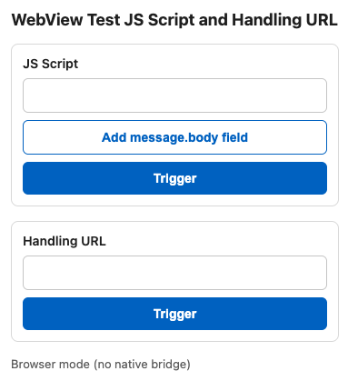

# WebView Dummy for Native Testing

Halaman HTML statis untuk mengetes handling WebView di sisi native (iOS dan Android). Dari halaman ini kamu bisa memanggil JS handler native dengan nama dan `message.body` bebas, atau memicu navigasi ke URL tertentu untuk dites intercept-nya.

Komunikasinya satu arah: web mengirim ke native, native tidak perlu membalas.



## Menjalankan di lokal

Jalankan dari folder project:

```
npx http-server -p 8080
```

Lalu buka `http://<ip-laptop>:8080/` dari device atau emulator.

Pakai `http-server`, bukan Live Preview bawaan VS Code. `http-server` menampilkan `404.html` untuk path yang tidak ada, sedangkan Live Preview mengembalikan error `ENOTDIR`. Di GitHub Pages, `404.html` juga otomatis dipakai.

## JS Script

1. Isi nama handler, misalnya `verifyPIN`. Akhiran `()` boleh ditulis, nanti diabaikan.
2. Kalau perlu mengirim data, klik **Add message.body field** lalu isi `key` dan `value`. Tambah baris sebanyak yang dibutuhkan. Tombol × menghapus satu baris.
3. Klik **Trigger**.

Baris yang `key`-nya kosong tidak ikut dikirim. Semua value dikirim sebagai string.

Status di bawah halaman menampilkan platform yang dipanggil dan body yang dikirim, atau `Native handler "<nama>" not found` kalau handler tidak terdaftar.

### iOS

Body dikirim lewat `postMessage`, jadi diterima sebagai `message.body` (dictionary). Tanpa field, body-nya `{}`.

```swift
contentController.add(self, name: "verifyPIN")

func userContentController(_ userContentController: WKUserContentController,
                           didReceive message: WKScriptMessage) {
    guard message.name == "verifyPIN" else { return }
    let body = message.body as? [String: Any] ?? [:]
    print(body["pin"] ?? "")
}
```

### Android

Halaman memanggil `window.Android.<nama>`. Interface `@JavascriptInterface` hanya menerima tipe primitif, jadi body dikirim sebagai JSON string:

- Tanpa field: `Android.verifyPIN()`
- Dengan field: `Android.verifyPIN("{\"pin\":\"123456\"}")`

Sediakan dua method kalau mau mengetes keduanya:

```kotlin
webView.addJavascriptInterface(Bridge(), "Android")

class Bridge {
    @JavascriptInterface
    fun verifyPIN() { /* tanpa body */ }

    @JavascriptInterface
    fun verifyPIN(body: String) {
        val json = JSONObject(body)
        Log.d("Bridge", json.optString("pin"))
    }
}
```

## Handling URL

1. Isi path, misalnya `/close` atau `/close?action=maintenance`. Garis miring di depan boleh tidak ditulis.
2. Klik **Trigger**.

Path ditambahkan ke alamat halaman. Kalau halaman dibuka di `http://host:8080/index.html`, hasilnya `http://host:8080/close?action=maintenance` (`/index.html` dibuang dulu).

Native bisa meng-intercept navigasi ini:

```swift
// iOS, WKNavigationDelegate
func webView(_ webView: WKWebView, decidePolicyFor navigationAction: WKNavigationAction,
             decisionHandler: @escaping (WKNavigationActionPolicy) -> Void) {
    if navigationAction.request.url?.path.hasSuffix("/close") == true {
        decisionHandler(.cancel)
        // handle close
        return
    }
    decisionHandler(.allow)
}
```

```kotlin
// Android, WebViewClient
override fun shouldOverrideUrlLoading(view: WebView, request: WebResourceRequest): Boolean {
    if (request.url.path?.endsWith("/close") == true) {
        // handle close
        return true
    }
    return false
}
```

Kalau native tidak meng-intercept, WebView memuat `404.html`. Halaman itu menampilkan "Berhasil redirect ke <url>" dan tombol **Back** ke halaman utama. Status HTTP-nya tetap 404, jadi `onReceivedHttpError` di Android tetap terpanggil.

## File

- `index.html`: halaman utama.
- `404.html`: halaman hasil redirect yang tidak di-intercept native.
- `preview.png`: screenshot tampilan.
